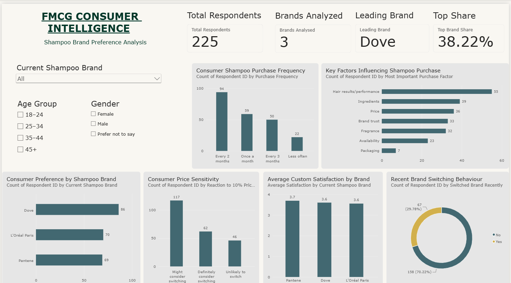

# FMCG CONSUMER INTELLIGENCE
### Consumer Preference & Brand Switching Analysis | Business Analyst Case Study

  <strong>BUSINESS ANALYSIS · CONSUMER BEHAVIOUR · DATA VISUALIZATION</strong>

---

## 01. Executive Summary

Understanding consumer preferences, purchasing behaviour and brand loyalty is essential for companies operating in the Fast-Moving Consumer Goods (FMCG) industry.

This project examines shampoo brand preferences across three leading brands — **Dove, Loreal Paris and Pantene** — to explore the factors influencing consumer choice, satisfaction, price sensitivity and brand switching.

Using a simulated dataset of 225 records, the analysis follows a business analysis workflow involving data preparation, exploratory analysis, KPI development, dashboard creation and business recommendations.

The objective is to demonstrate how consumer data can be transformed into structured insights that support business decision-making.

## 02. Business Problem

FMCG brands operate in a competitive market where consumers have multiple product choices and changing expectations.

Businesses need to understand:

- Which brands attract the highest consumer preference?
- What factors influence shampoo purchasing decisions?
- How frequently do consumers purchase shampoo?
- How satisfied are consumers with their current brands?
- How sensitive are consumers to price increases?
- What patterns can be observed in brand switching behaviour?

Without analysing these factors, businesses may struggle to identify opportunities to improve customer retention, product positioning and pricing strategies.

**Business challenge:** Analyse consumer preference and purchasing behaviour to identify potential opportunities for improving brand competitiveness and customer loyalty.

## 03. Project Objectives

1. Evaluate consumer preference across three shampoo brands.
2. Analyse purchasing frequency and purchase decision factors.
3. Compare customer satisfaction across brands.
4. Examine consumer responses to a hypothetical 10% price increase.
5. Identify the proportion of respondents reporting recent brand switching.
6. Translate analytical findings into practical business recommendations.

## 04. Project Scope

| Area | Description |
|---|---|
| Industry | Fast-Moving Consumer Goods (FMCG) |
| Product category | Shampoo |
| Brands | Dove, Loreal Paris, Pantene |
| Dataset size | 225 simulated records |
| Analysis type | Descriptive and exploratory |
| Tools | Excel, Power Query, Power BI |
| Deliverable | Interactive analytical dashboard |

## 05. Analytical Approach

The project follows a structured analytical workflow.

**Phase 1 — Data Understanding**

- Reviewed dataset structure and available variables.
- Identified relevant consumer behaviour attributes.
- Examined brand, purchasing, pricing and satisfaction fields.

**Phase 2 — Data Preparation**

- Removed unnecessary introductory rows.
- Promoted the correct headers.
- Reviewed column data types.
- Checked respondent identifiers for duplicates.
- Prepared the dataset for analysis.

**Phase 3 — Exploratory Data Analysis**

Analysed the following dimensions:

- Brand preference and market share within the sample.
- Purchase frequency distribution.
- Most important purchase decision factors.
- Average satisfaction by brand.
- Price sensitivity.
- Recent brand switching.

**Phase 4 — Dashboard Development**

Developed an interactive Power BI dashboard containing KPI cards, charts and slicers to support exploration of consumer behaviour patterns.

**Phase 5 — Business Recommendations**

Interpreted the findings and translated them into potential actions relating to customer retention, pricing, product positioning and customer experience.

## 06. Dashboard Preview

**Dashboard:** Power BI interactive report.

**Available analysis:** Brand preference, purchase frequency, purchase factors, satisfaction, price sensitivity and brand switching.

## 07. Key Performance Indicators

| KPI | Result |
|---|---:|
| Total simulated respondents | 225 |
| Brands analysed | 3 |
| Leading brand in sample | Dove |
| Leading brand share | 38.22% |
| Highest average satisfaction | Pantene – 3.70/5 |

## 08. Key Analytical Findings

### 8.1 Brand Preference

| Brand | Respondents | Share |
|---|---:|---:|
| Dove | 86 | 38.22% |
| Loreal Paris | 70 | 31.11% |
| Pantene | 69 | 30.67% |

**Insight:** Dove records the highest preference among the simulated respondents, although the distribution across the three brands is relatively close.

**Business implication:** Competing brands could explore product differentiation, customer engagement and targeted positioning strategies.

### 8.2 Purchase Behaviour

| Purchase Frequency | Respondents |
|---|---:|
| Every 2 months | 94 |
| Once a month | 59 |
| Every 3 months | 50 |
| Less often | 22 |

**Insight:** Purchasing every two months is the most common reported frequency in the simulated dataset.

**Business implication:** Businesses could consider repeat-purchase campaigns and promotional activities aligned with potential replenishment cycles.

### 8.3 Purchase Decision Factors

| Purchase Factor | Respondents |
|---|---:|
| Performance / Hair Results | 55 |
| Ingredients | 39 |
| Price | 36 |
| Brand Trust | 33 |
| Fragrance | 32 |
| Availability | 23 |
| Packaging | 7 |

**Insight:** Product performance is the most frequently selected purchase factor, followed by ingredients and price.

**Business implication:** Marketing strategies could place greater emphasis on product benefits, ingredients and perceived value.

### 8.4 Customer Satisfaction

| Brand | Average Satisfaction |
|---|---:|
| Pantene | 3.70 / 5 |
| Dove | 3.60 / 5 |
| Loreal Paris | 3.56 / 5 |

**Insight:** Pantene records the highest average satisfaction score in this sample.

**Business implication:** Brands could investigate the factors associated with satisfaction and identify opportunities to improve the overall customer experience.

### 8.5 Price Sensitivity

| Response to 10% Price Increase | Respondents |
|---|---:|
| Might consider switching | 117 |
| Definitely consider switching | 62 |
| Unlikely to switch | 46 |

**Insight:** 79.56% of respondents indicated that they might or would definitely consider switching following a hypothetical 10% price increase.

**Business implication:** Pricing decisions should consider perceived product value, competitive positioning and customer retention strategies.

### 8.6 Brand Switching Behaviour

| Recent Brand Switching | Respondents |
|---|---:|
| No | 158 |
| Yes | 67 |

**Insight:** Approximately 29.78% of respondents reported switching brands recently.

**Business implication:** Businesses could investigate switching motivations and strengthen customer retention initiatives.

## 09. Business Recommendations

Based on the descriptive analysis, the following opportunities are identified:

**1. Strengthen Product Differentiation**

Emphasise product performance, ingredients and relevant customer benefits in product positioning and marketing communication.

**2. Develop Customer Retention Strategies**

Consider loyalty programmes, repeat-purchase incentives and targeted engagement initiatives to encourage continued purchasing.

**3. Evaluate Pricing and Value Perception**

Assess how consumers perceive product value and consider the potential impact of price changes before implementing pricing decisions.

**4. Improve Customer Experience**

Investigate satisfaction drivers and identify areas where product quality, availability and customer experience could be improved.

**5. Understand Brand Switching**

Explore why consumers change brands and use those insights to identify possible retention opportunities.

## 10. Tools & Technologies

| Tool | Application |
|---|---|
| Microsoft Excel | Data exploration, PivotTables and analysis |
| Power Query | Data cleaning and transformation |
| Power BI Desktop | Dashboard development and visualization |
| DAX | KPI calculations and analytical measures |
| GitHub | Project documentation and version-controlled portfolio storage |

## 11. Limitations & Assumptions

- The dataset contains 225 simulated and fictional records.
- The results are intended to demonstrate analytical techniques and are not representative of actual shampoo consumers.
- The analysis is descriptive and does not establish causal relationships.
- The brand preference percentages represent shares within this simulated sample, not actual market share.
- The response to a 10% price increase represents a hypothetical scenario rather than observed purchasing behaviour.
- The findings should not be used as validated market research or commercial forecasts.

## 12. Project Deliverables

| Deliverable | File |
|---|---|
| Simulated survey dataset | `shampoo_brand_preference_simulated_225.xlsx` |
| Power BI dashboard | `consumer_insights_intelligence.pbix` |
| Dashboard preview | `shampoo-dashboard.png` |

## 13. Conclusion

This case study demonstrates a structured approach to analysing consumer behaviour in an FMCG product category.

By combining data preparation, exploratory analysis, KPI development and interactive visualization, the project illustrates how raw data can be converted into understandable business insights and potential strategic recommendations.

The project reflects foundational Business Analyst capabilities, including problem understanding, analytical thinking, data interpretation, stakeholder-oriented communication and business recommendation development.

---

### Project Information

**Project:** FMCG Consumer Intelligence – A Study of Shampoo Brand Preferences

**Category:** Business Analysis / Data Analytics

**Project Level:** Beginner Portfolio Case Study

**Author:** Pallavi Sirigiri

**Tools:** Microsoft Excel | Power Query | Power BI | DAX | GitHub

**Data Classification:** Simulated / Fictional Academic Dataset
